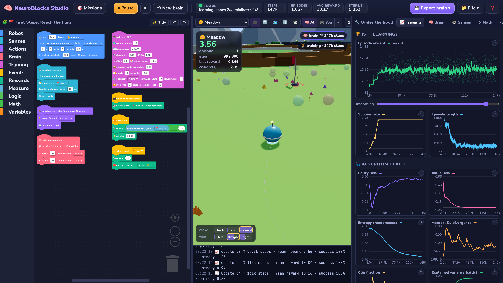
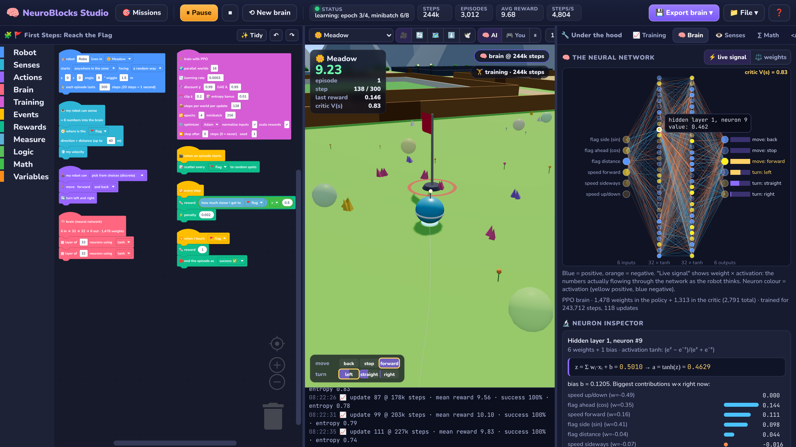
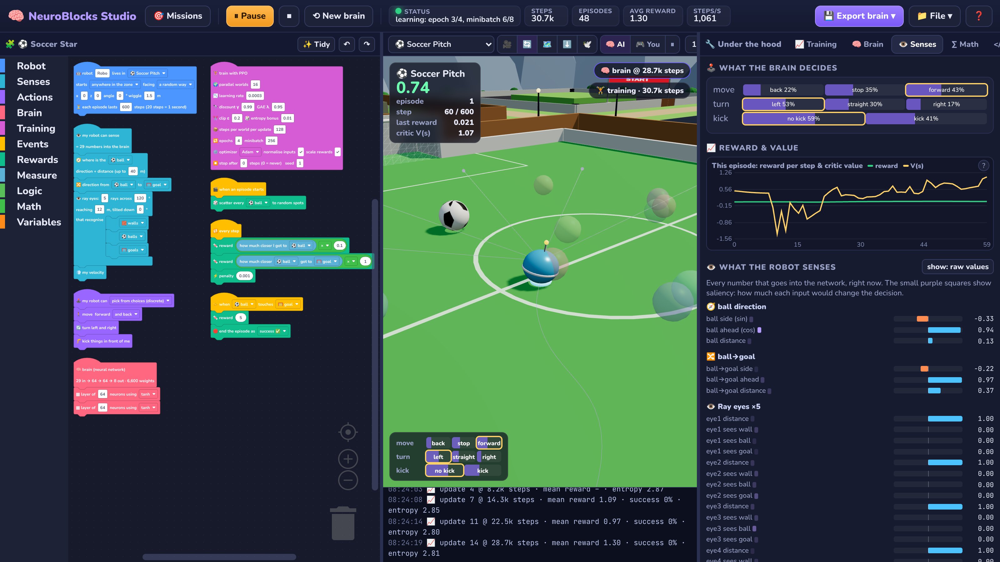
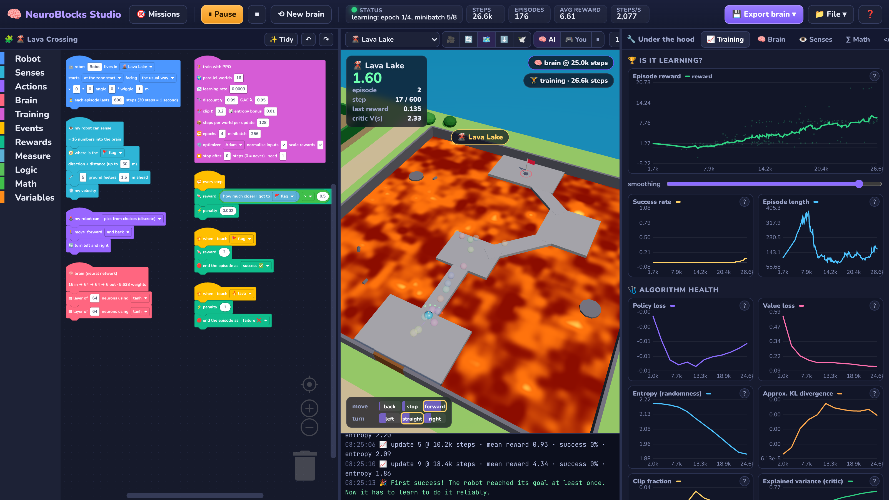
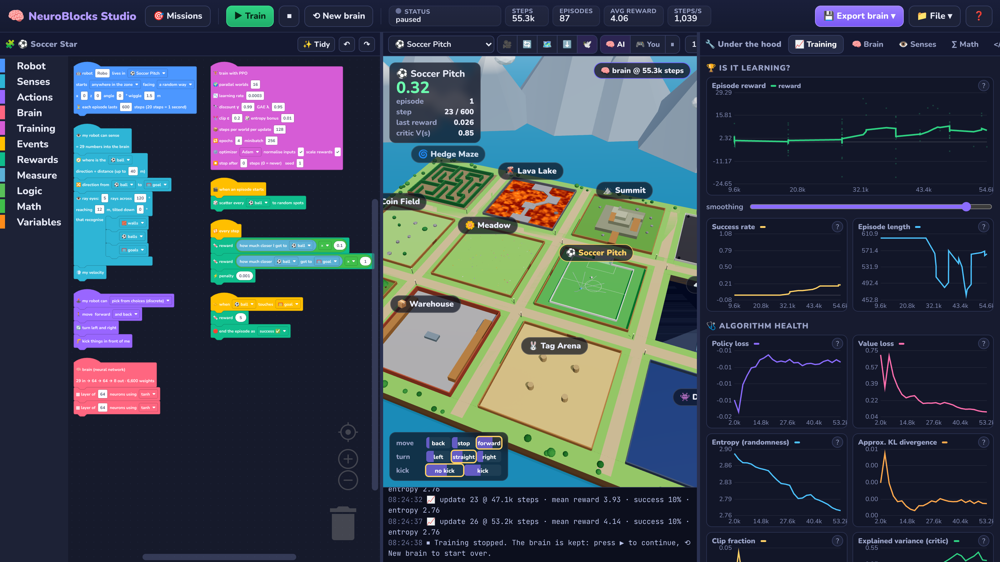
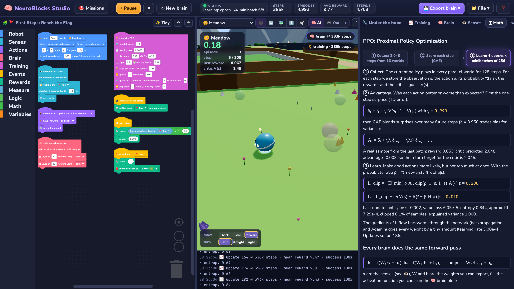
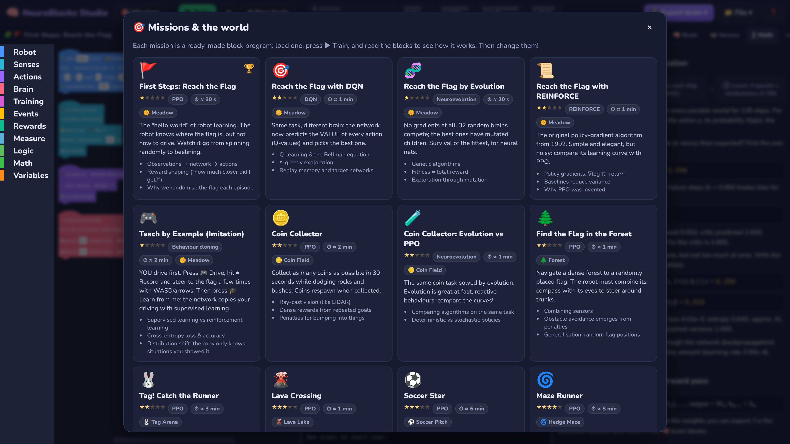

<div align="center">

# 🧠 NeuroBlocks Studio

**Scratch-style blocks for machine learning.** Build a robot's senses, actions, brain and rewards from blocks, drop it into a 3D world, and watch a neural network learn, with every number under the hood on display. Export the trained weights as JSON, ONNX or PyTorch.

### ▶ [Open the studio in your browser](https://eefamilyai.github.io/neuroblocks-studio/)

Runs entirely in your browser. No install, no server, no account.<br>
The neural network, backpropagation, PPO, DQN, REINFORCE, neuroevolution and the physics are all written from scratch in TypeScript: no ML libraries, nothing hidden.



</div>

---

## What you can do

| | |
|---|---|
| 🧩 **Program learning, not moves** | Snap together blocks for what the robot **senses** (network inputs), what it **can do** (outputs), its **brain** (layers & activations), the **learning algorithm**, and **rewards**: Scratch-style event hats like *"when I touch 🪙 coin → reward 1"*. |
| 🏝️ **A prebuilt 3D world** | An island with 12 training zones: meadow, coin field, hedge maze, lava lake, mountain summit, race track, soccer pitch, sky parkour, forest, warehouse, tag arena, dodge arena, plus free roam with all gates open. Pick any zone, then train anything you like in it. |
| 🧱 **Build mode** | Place your own coins, flags, balls, crates, pads, runner/chaser bots, walls, ramps, lava, ice and bounce pads, and set the start point by clicking in 3D. |
| 🏋️ **5 learning methods** | **PPO** (actor-critic, discrete or continuous), **DQN** (replay memory, target network, double DQN), **REINFORCE** (with or without baseline), **Neuroevolution** (genetic algorithm), and **Behaviour cloning**: drive with the keyboard, record, and let the network copy you. Then fine-tune with PPO. |
| 👻 **Parallel worlds** | 16 copies of your robot train at once in a background thread; see them all as ghosts. The robot you watch always uses the newest brain. |
| 🔧 **Under the hood** | Live learning curves with run-vs-run comparison, a clickable network diagram (every neuron's `z = Σ w·x + b` with the actual numbers), weight matrices and histograms, the exact input vector with saliency, action probabilities, critic value, Q-values, the algorithm's equations with live values, an exploration heatmap and a **value map** painted on the ground. |
| </> **See the code** | Your event blocks compile to readable JavaScript, and the network is shown as PyTorch code. |
| 💾 **Export the brain** | **JSON** (readable, re-importable), **ONNX** (Netron, onnxruntime, Unity Sentis…), or a standalone **PyTorch/NumPy `.py`** with the weights inside. All three are tested to reproduce the browser's outputs to about 1e‑7. |
| 🎯 **17 missions** | Ready-made, fully editable block programs, from "reach the flag in 30 seconds" to soccer, racing with smooth controls, mazes, parkour and crate pushing. Each one explains what it teaches and suggests an experiment to try next. |

<table>
<tr>
<td width="50%"><br><b>🧠 Brain tab.</b> Click any neuron to see its weighted sum and activation, with the biggest contributions.</td>
<td width="50%"><br><b>👁️ Senses tab.</b> Every input number, the decision probabilities, and the critic's value, live.</td>
</tr>
<tr>
<td><br><b>👻 16 robots training in parallel</b> on the Lava Lake bridges.</td>
<td><br><b>🏝️ The island.</b> Click a zone label to train there.</td>
</tr>
<tr>
<td><br><b>∑ Math tab.</b> The algorithm, step by step, using your run's numbers.</td>
<td><br><b>🎯 Missions.</b> Load one, press ▶, then change the blocks.</td>
</tr>
</table>

## Quick start

1. Open the studio. The first mission (**🚩 Reach the Flag**) is already loaded.
2. Press **▶ Train**. Within about 30 seconds the reward curve climbs and the success rate hits 100%.
3. Open **🧠 Brain** while it drives and click neurons. Open **👁️ Senses** to see exactly what the network receives.
4. Change something: delete the *"how much closer I got"* reward, add ray eyes, try **🧬 Evolution** instead of PPO. Press **⟲ New brain** and compare the curves (the old run stays dashed).
5. **💾 Export brain** to take it anywhere.

Keyboard: `Ctrl+Enter` train/pause · `Ctrl+S` save project · in 🎮 mode `WASD`/arrows drive, `Space` jump, `F` kick, `Q`/`E` slide.

## How it works (the "backend")

```
blocks (Blockly) ──compile──► AgentSpec ──► Web Worker ──► VecEnv (16 × Env) ◄──► algorithm (PPO / DQN / …)
   │                           │                │                                     │
   │ events → JavaScript       │ senses/actions │ brain snapshots, stats, ghosts      │ MLP + backprop + Adam
   ▼                           ▼                ▼                                     ▼
Code tab                  3D showcase (Three.js) runs the newest brain at real-time speed
```

| Folder | What's inside |
|---|---|
| [`src/ml/nn.ts`](src/ml/nn.ts) | Dense layers with hand-written `forward`/`backward` (the chain rule, layer by layer), 8 activation functions, weight init. |
| [`src/ml/optim.ts`](src/ml/optim.ts) | SGD, momentum, RMSProp, Adam, gradient clipping. |
| [`src/ml/policy.ts`](src/ml/policy.ts) | Softmax/multi-discrete and Gaussian policies: sampling, log-probabilities, entropy and their gradients. |
| [`src/ml/algos/`](src/ml/algos) | `ppo.ts`, `dqn.ts`, `reinforce.ts`, `evolution.ts`, `bc.ts`, plus the vectorised environment and trainer. Each file starts with a plain-English explanation. |
| [`src/sim/`](src/sim) | The world generator, collision geometry (spheres vs rotated boxes and cylinders, ray casts on a spatial grid), the robot physics, sensors, NPC bots, and the `ScriptAPI` that reward blocks call. |
| [`src/blocks/`](src/blocks) | Block definitions, code generators, the compiler and the missions. |
| [`src/render/`](src/render) | Three.js world, robot, objects, ghosts, rays, heatmap and value map. |
| [`src/export/`](src/export) | ONNX writer (a tiny protobuf encoder) and the PyTorch script generator. |

Physics runs at 60 Hz and the brain decides at 20 Hz (every 3 physics ticks), like most robot-learning setups.

## Using an exported brain

**Python + ONNX** (`pip install onnxruntime numpy`):

```python
import numpy as np, onnxruntime as ort

sess = ort.InferenceSession("robo.onnx")
obs = np.zeros((1, sess.get_inputs()[0].shape[1]), dtype=np.float32)  # your sensor values, in the order listed in the Code tab
outputs = sess.run(None, {"obs": obs})
print(outputs[0])   # logits (or q_values / action_mean); outputs[1] = critic value if present
```

Observation normalisation is baked into the ONNX graph, so feed raw sensor values.

**PyTorch script**: `python robo_brain.py` runs a NumPy forward pass and, if PyTorch is installed, the same network as an `nn.Module` (`torch_model()`) that you can fine-tune.

**JSON**: `net.layers[i].W` is a row-major `[out × in]` matrix (PyTorch `nn.Linear` layout), `b` the bias, plus `obsNorm`, the action `space` and `obsLabels`. Import it back with *File → Import a brain*.

## Run it locally

```bash
git clone https://github.com/eefamilyai/neuroblocks-studio
cd neuroblocks-studio
npm install
npm run dev            # http://localhost:5173
```

```bash
npm test               # gradient checks, physics, every mission, and "does each algorithm actually learn?"
npm run test:export    # exports brains and checks them with onnx.checker + onnxruntime (needs: pip install onnx onnxruntime numpy)
npm run build          # static site in dist/
npm run build:single   # ONE self-contained HTML file in dist-single/ (works offline, double-click to open)
npm run bench -- soccer 1000000   # train a mission headlessly in Node and print its learning curve
```

**Install it like an app:** in Chrome or Edge, use the install icon in the address bar (it's a PWA and works offline after the first visit). An offline single-file copy is also published at [`/neuroblocks-studio-offline.html`](https://eefamilyai.github.io/neuroblocks-studio/neuroblocks-studio-offline.html).

## Missions

| | Mission | Algorithm | Teaches |
|---|---|---|---|
| 🚩 | First Steps: Reach the Flag | PPO | observations → network → actions, reward shaping |
| 🎯 | Reach the Flag with DQN | DQN | Q-learning, ε-greedy, replay memory, target networks |
| 🧬 | Reach the Flag by Evolution | Neuroevolution | genetic algorithms, fitness, mutation |
| 📜 | Reach the Flag with REINFORCE | REINFORCE | policy gradients, baselines |
| 🎮 | Teach by Example | Behaviour cloning | supervised vs reinforcement learning |
| 🪙 | Coin Collector | PPO | ray-cast vision, dense rewards, penalties |
| 🧪 | Coins: Evolution vs PPO | Neuroevolution | comparing algorithms |
| 🌲 | Find the Flag in the Forest | PPO | combining sensors, obstacle avoidance |
| 🐰 | Tag! Catch the Runner | PPO | moving targets, pursuit |
| 🌋 | Lava Crossing | PPO | terminal penalties, ground probes, discount γ |
| ⚽ | Soccer Star | PPO | multi-part rewards, reward hacking |
| 🌀 | Maze Runner | PPO | sparse rewards, curricula, exploration |
| 🏎️ | Race Track | PPO (continuous) | Gaussian policies, exploration noise |
| ⛰️ | Climb the Summit | PPO | progress rewards, local optima |
| ☁️ | Sky Parkour | PPO | timing (jumping), terminal states |
| 👾 | Dodge & Collect | PPO | competing objectives, 360° vision |
| 📦 | Warehouse Crate Push | PPO | hard exploration, indirect control |

## License

MIT. Use it, remix it, teach with it.
