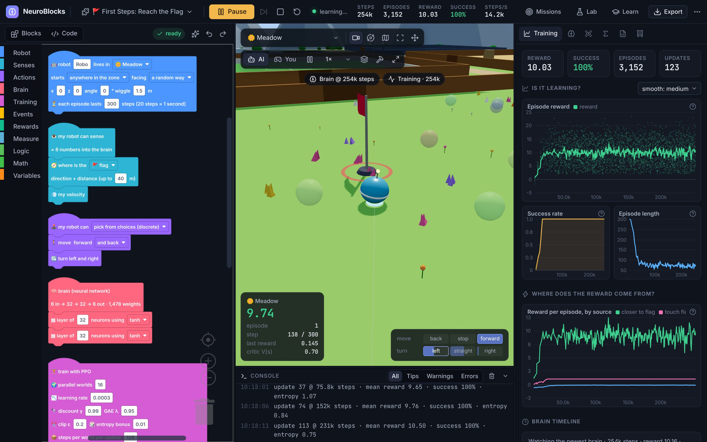
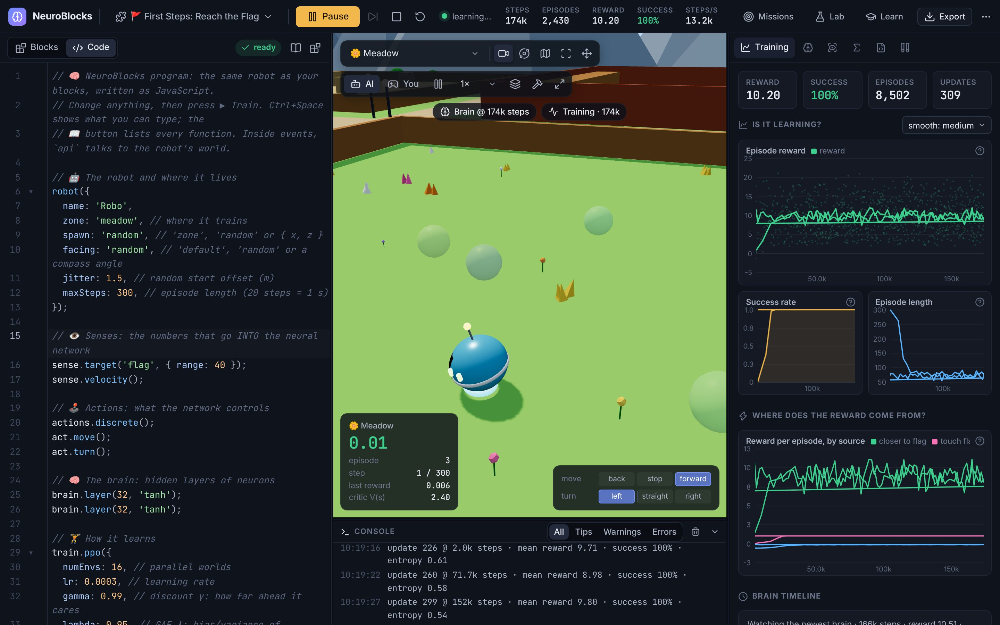
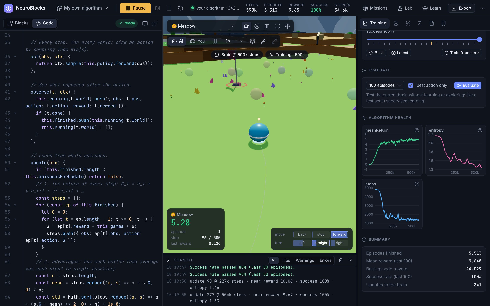
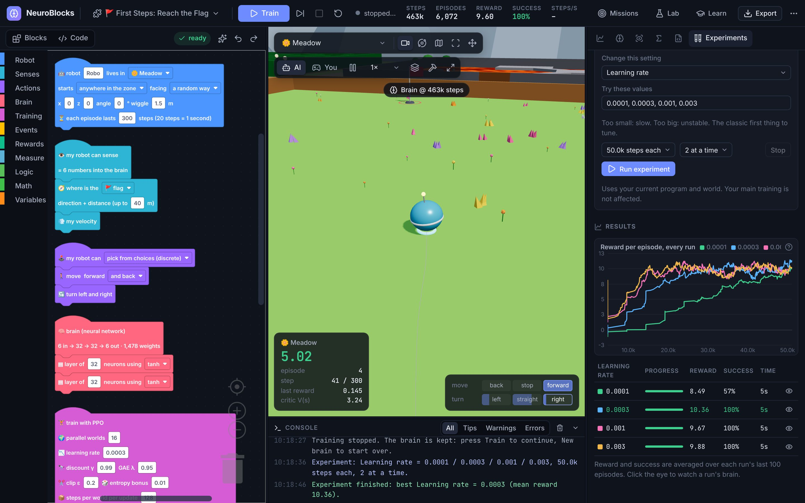
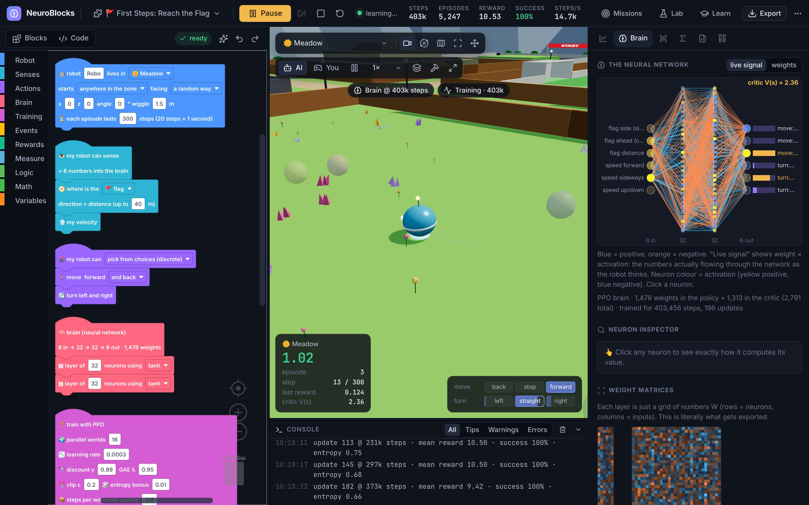
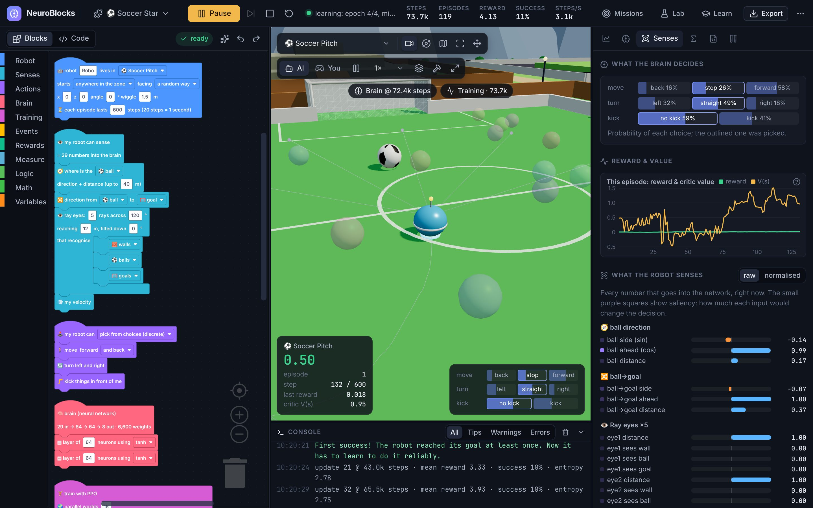
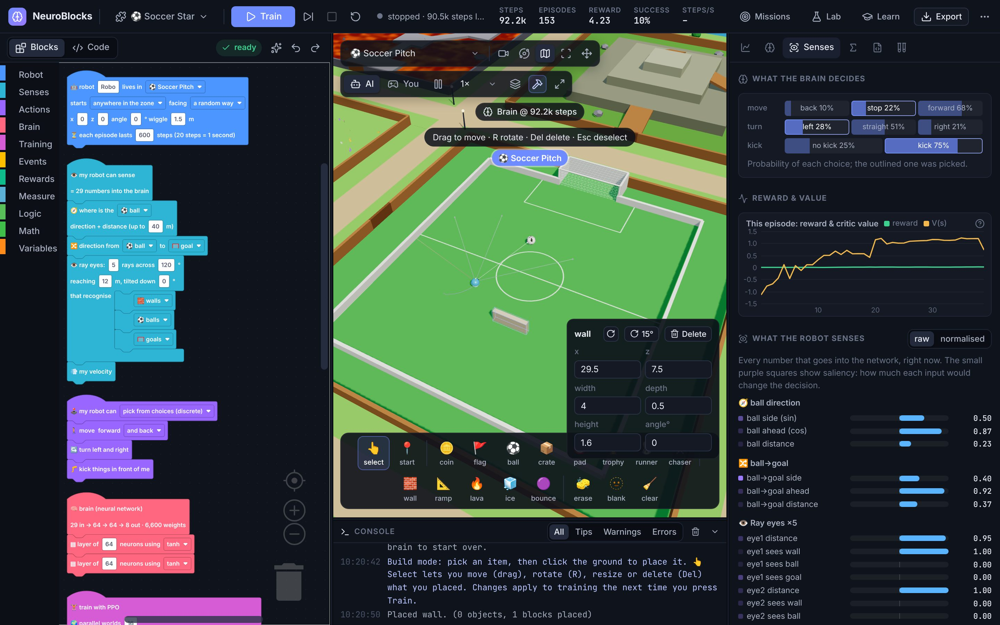
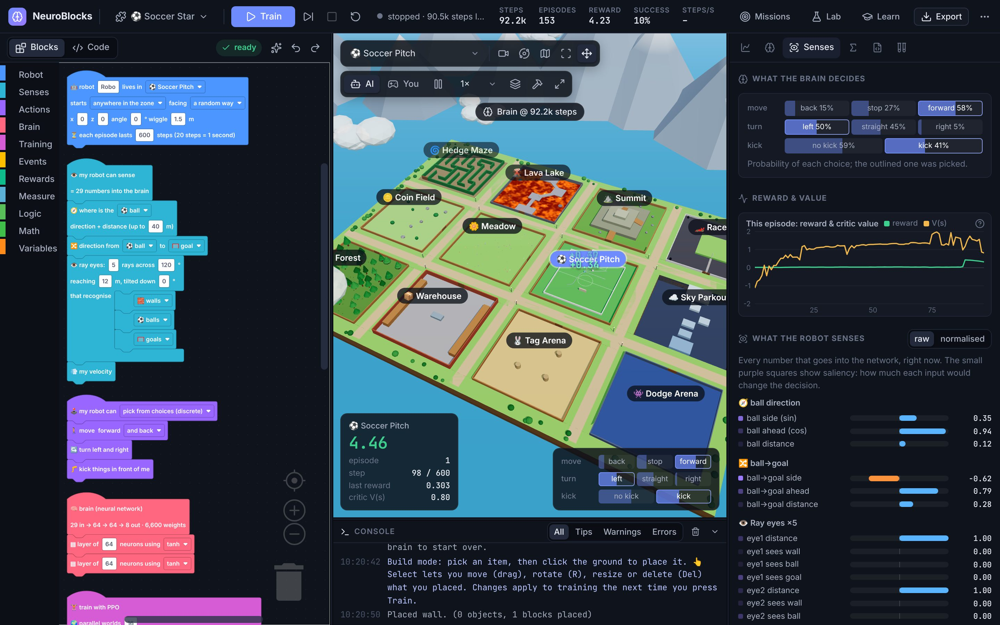
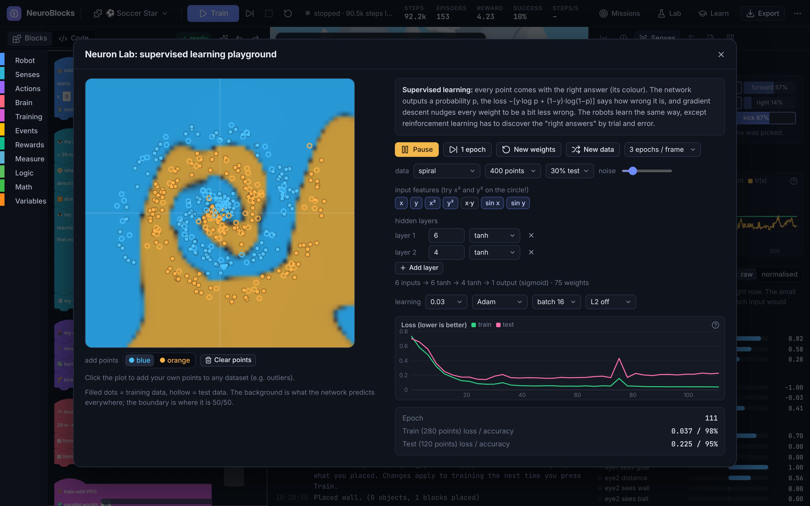

<div align="center">

# 🧠 NeuroBlocks Studio

**Scratch-style blocks (or real code) for machine learning.** Build a robot's senses, actions, brain and rewards, drop it into a 3D world, and watch a neural network learn, with every number under the hood on display. Write your own learning algorithms, run experiments, and export the trained weights as JSON, ONNX or PyTorch.

### ▶ [Open the studio in your browser](https://eefamilyai.github.io/neuroblocks-studio/)

Runs entirely in your browser. No install, no server, no account.<br>
The neural network, backpropagation, PPO, DQN, REINFORCE, neuroevolution and the physics are all written from scratch in TypeScript: no ML libraries, nothing hidden.



</div>

---

## What you can do

| | |
|---|---|
| 🧩 **Program learning, not moves** | Snap together blocks for what the robot **senses** (network inputs), what it **can do** (outputs), its **brain** (layers & activations), the **learning algorithm** and **rewards**: Scratch-style event hats like *"when I touch 🪙 coin → reward 1"*. |
| ⌨️ **…or write code** | Switch the editor to **Code** and the same program becomes JavaScript, with every setting spelled out. Autocomplete, a searchable reference, inline errors with line numbers and infinite-loop protection. Code can do more than blocks: your own senses with any maths, levels built from code (`world.add`, `world.wall`), every hyperparameter. |
| 🧪 **Your own learning algorithm** | `train.custom({ setup, act, observe, update })` replaces PPO with **your** code, using a small toolkit on the same from-scratch library: `ctx.mlp`, `net.forward`, `net.backward`, `ctx.adam`, sampling, log-probability gradients. A complete REINFORCE in ~40 lines is included as a template, and it learns. |
| 🏝️ **A prebuilt 3D world** | An island with 12 training zones (meadow, coin field, hedge maze, lava lake, mountain, race track, soccer pitch, sky parkour, forest, warehouse, tag arena, dodge arena) plus free roam. |
| 🧱 **Build mode** | Place coins, flags, balls, crates, pads, runner/chaser bots, walls, ramps, lava, ice and bounce pads. **Select** what you placed to drag it, rotate it (R), resize it or delete it. Empty a zone to build a level from scratch. |
| 🌍 **World rules** | Change gravity, friction, air drag, bot speed, kick power, masses and how often the brain decides, per program. |
| 🏋️ **5 learning methods + yours** | **PPO** (discrete or continuous), **DQN** (replay, target network, double DQN), **REINFORCE**, **neuroevolution**, **behaviour cloning** (drive with the keyboard, the network copies you) and **train.custom**. |
| 🎛️ **Training controls** | Train **one update at a time** and look at what changed. Learning-rate & entropy **schedules**, **stop** at a success rate, reward or time, **memory** (frame stacking), a **speed limit** to watch the ghosts learn in real time. |
| 🕰️ **Brain timeline** | Brains are saved as training goes. Scrub back to watch how the robot drove at any point, jump to the **best** one, or train again from there. |
| ✅ **Evaluation** | Test a frozen brain on fresh episodes (no exploration, no learning): success rate, reward ± std, a histogram and the reward breakdown. The RL version of a test set. |
| 🔬 **Experiments** | Hyperparameter sweeps: train several brains side by side in parallel background workers, changing one setting (learning rate, γ, entropy, network width/depth, worlds, algorithm, seed, memory…), and compare the curves. |
| 🔧 **Under the hood** | Live learning curves with run-vs-run comparison, **where the reward comes from** (per reward source), a clickable network diagram (every neuron's `z = Σ w·x + b` with the actual numbers), weight matrices, the exact input vector with saliency, action probabilities, critic value, Q-values, the algorithm's equations with live values, a heatmap and a **value map** painted on the ground. |
| 💾 **Export** | **JSON** (re-importable), **ONNX** (Netron, onnxruntime, Unity Sentis…), a standalone **PyTorch/NumPy `.py`**, training logs as **CSV**, the program as **.js**. Exports are tested to reproduce the browser's outputs to about 1e‑7. |
| 🧪 **Neuron Lab** | Supervised learning playground: a network separates 2D data (circle, XOR, spiral, moons…) or **points you draw yourself**. Watch the decision boundary bend; play with features, layers, learning rate, optimizer, batch size, L2 regularisation and the train/test split. |
| 🎯 **17 missions** | Ready-made, editable programs, from "reach the flag in 15 seconds" to soccer, racing with smooth controls, mazes, parkour and crate pushing. They open as blocks or as code. |

<table>
<tr>
<td width="50%"><br><b>Code mode.</b> The same robot as JavaScript; train straight from the editor.</td>
<td width="50%"><br><b>Your own algorithm.</b> REINFORCE written in <code>train.custom</code>; its logged numbers become charts.</td>
</tr>
<tr>
<td><br><b>Experiments.</b> Four learning rates trained in parallel workers.</td>
<td><br><b>Brain tab.</b> Click any neuron to see its weighted sum and activation.</td>
</tr>
<tr>
<td><br><b>Senses tab.</b> Every input number, the decision probabilities and the critic's value, live.</td>
<td><br><b>Build mode.</b> Place, select, rotate and resize your own course.</td>
</tr>
<tr>
<td><br><b>The island.</b> 12 zones; click a label to train there.</td>
<td><br><b>Neuron Lab.</b> A network learning a spiral, with engineered features.</td>
</tr>
</table>

## Quick start

1. Open the studio. The first mission (**🚩 Reach the Flag**) is already loaded.
2. Press **▶ Train**. Within about 15 seconds the reward curve climbs and the success rate hits 100%.
3. Open **Brain** while it drives and click neurons. Open **Senses** to see exactly what the network receives.
4. Change something: delete the *"how much closer I got"* reward, add ray eyes, try **Evolution** instead of PPO. Press **New brain** and compare the curves (the old run stays dashed). Or run it as an **Experiment**.
5. Switch the editor to **Code** to see (and edit) the program as JavaScript.
6. **Export** the brain to take it anywhere.
7. New to neural networks? Start with the **Lab** in the top bar.

Keyboard: `Ctrl+Enter` train/pause · `Ctrl+S` save · `Ctrl+Space` code suggestions · in "You" mode `WASD`/arrows drive, `Space` jump, `F` kick, `Q`/`E` slide · in build mode `R` rotate, `Del` delete, `Esc` deselect.

## Code mode in 30 seconds

```js
robot({ zone: 'meadow', spawn: 'random', facing: 'random', maxSteps: 300 });

sense.target('flag');          // 3 inputs: direction + distance to the flag
sense.velocity();              // 3 inputs
sense.custom('speed', () => api.speed() / 6);   // your own input

actions.discrete();
act.move();
act.turn();

brain.layer(32, 'tanh');
brain.layer(32, 'tanh');

train.ppo({ lr: 3e-4, numEnvs: 16, lrSchedule: 'linear', targetSuccess: 0.95 });
world.physics({ gravity: 9.8 });

on.start(() => api.randomize('flag'));
on.step(() => {
  api.reward(api.closer('flag') * 0.5, 'closer to flag');   // the label shows up in the reward breakdown
  api.penalty(0.002, 'time');
});
on.touch('flag', () => {
  api.reward(1, 'goal');
  api.end(true);
});
```

The 📖 button in the editor lists every function (`robot`, `sense.*`, `act.*`, `brain.*`, `train.*`, `world.*`, `on.*`, and the ~50 `api.*` calls available inside events). Code from a project file someone else made is not run until you confirm.

### Your own algorithm

```js
train.custom({
  numEnvs: 16,
  setup(ctx) {
    this.policy = ctx.mlp([32, 32], 'tanh');      // the brain: what the robot uses and what gets exported
    this.opt = ctx.adam(this.policy, 0.003);
    this.batch = [];
  },
  act(obs, ctx) {
    return ctx.sample(this.policy.forward(obs));  // one choice per action
  },
  observe(t, ctx) {
    this.batch.push(t);                           // { obs, action, reward, done, next, world, … }
  },
  update(ctx) {
    // …compute a loss gradient dLogits, then:
    // this.policy.zeroGrad(); this.policy.backward(dLogits, n); this.opt.step();
    ctx.log({ loss: 0 });                         // → a chart in the Training tab
    return false;                                 // true when the brain changed
  },
});
```

**Project → New code project: your own algorithm** opens a complete REINFORCE written this way.

## How it works (the "backend")

```
blocks (Blockly) ─┐
                  ├─compile─► AgentSpec ──► Web Worker ──► VecEnv (16 × Env) ◄──► algorithm (PPO / DQN / … / yours)
code (JavaScript) ┘              │                │                                     │
                                 │                │ brain snapshots, stats, ghosts      │ MLP + backprop + Adam
                                 ▼                ▼                                     ▼
                         3D view (Three.js) runs the newest brain at real-time speed; panels show everything
```

| Folder | What's inside |
|---|---|
| [`src/ml/nn.ts`](src/ml/nn.ts) | Dense layers with hand-written `forward`/`backward` (the chain rule, layer by layer), 8 activation functions, weight init. The matrix loops are register-tiled (2 samples × 4 neurons per pass) for ~2× speed, and tested against the plain textbook loops. |
| [`src/ml/optim.ts`](src/ml/optim.ts) | SGD, momentum, RMSProp, Adam, gradient clipping. |
| [`src/ml/policy.ts`](src/ml/policy.ts) | Softmax/multi-discrete and Gaussian policies: sampling, log-probabilities, entropy and their gradients. |
| [`src/ml/algos/`](src/ml/algos) | `ppo.ts`, `dqn.ts`, `reinforce.ts`, `evolution.ts`, `bc.ts`, `custom.ts` (your own), `evaluate.ts`, the vectorised environment and the trainer (schedules). Each file starts with a plain-English explanation. |
| [`src/sim/`](src/sim) | The world generator, collision geometry (spheres vs rotated boxes and cylinders, ray casts on a spatial grid), robot physics (configurable), sensors, frame stacking, NPC bots, and the `ScriptAPI` that rewards call. |
| [`src/blocks/`](src/blocks) | Block definitions, code generators, the block compiler and the missions. |
| [`src/code/`](src/code) | Code mode: the builder runtime and validation (`runtime.ts`), infinite-loop protection (`guard.ts`), blocks → code (`fromBlocks.ts`), the API reference (`docs.ts`), templates. |
| [`src/app/`](src/app) | The studio: shell & layout, block and code editors, the 3D world view (HUD, build mode), experiments, dialogs. |
| [`src/render/`](src/render) | Three.js world (per-zone chunks), robot, objects, ghosts, rays, heatmap and value map; adaptive render quality. |
| [`src/ui/`](src/ui) | Panels (training, brain, senses, math, code), charts, Neuron Lab, icons. |
| [`src/export/`](src/export) | ONNX writer (a tiny protobuf encoder) and the PyTorch script generator. |

Physics runs at 60 Hz and the brain decides at 20 Hz (every 3 physics ticks) by default, like most robot-learning setups.

### Performance

- **Training** runs in a background worker. The first mission trains at roughly 15,000 environment steps per second on our test machine (about 2.5× faster than the first version), bigger networks proportionally slower.
- **The 3D view** adapts: in *Auto* quality it lowers the render resolution (and, if needed, turns shadows off) when frames get slow, redraws shadows every other frame, and slows to a few frames per second when nothing moves. Settings let you pick High/Medium/Low and cap the frame rate.
- **Loading**: the code editor, the Lab and the training worker are separate files, downloaded only when needed.

## Using an exported brain

**Python + ONNX** (`pip install onnxruntime numpy`):

```python
import numpy as np, onnxruntime as ort

sess = ort.InferenceSession("robo.onnx")
obs = np.zeros((1, sess.get_inputs()[0].shape[1]), dtype=np.float32)  # your sensor values, in the order listed in the Code tab
outputs = sess.run(None, {"obs": obs})
print(outputs[0])   # logits (or q_values / action_mean); outputs[1] = critic value if present
```

Observation normalisation is baked into the ONNX graph, so feed raw sensor values. With memory (frame stacking) the input is the last N observations in a row, newest first.

**PyTorch script**: `python robo_brain.py` runs a NumPy forward pass and, if PyTorch is installed, the same network as an `nn.Module` (`torch_model()`) that you can fine-tune.

**JSON**: `net.layers[i].W` is a row-major `[out × in]` matrix (PyTorch `nn.Linear` layout), `b` the bias, plus `obsNorm`, the action `space` and `obsLabels`. Import it back with *Project → Import a brain*.

## Run it locally

```bash
git clone https://github.com/eefamilyai/neuroblocks-studio
cd neuroblocks-studio
npm install
npm run dev            # http://localhost:5173
```

```bash
npm test               # gradient checks, physics, every mission (blocks and code), code-mode errors, your-own-algorithm learning…
npm run test:export    # exports brains and checks them with onnx.checker + onnxruntime (needs: pip install onnx onnxruntime numpy)
npm run build          # static site in dist/
npm run build:single   # ONE self-contained HTML file in dist-single/ (works offline, double-click to open)
npm run bench -- soccer 1000000   # train a mission headlessly in Node and print its learning curve
```

**Install it like an app:** in Chrome or Edge, use the install icon in the address bar (it's a PWA and works offline after the first visit). An offline single-file copy is also published at [`/neuroblocks-studio-offline.html`](https://eefamilyai.github.io/neuroblocks-studio/neuroblocks-studio-offline.html).

## Missions

| | Mission | Algorithm | Teaches |
|---|---|---|---|
| 🚩 | First Steps: Reach the Flag | PPO | observations → network → actions, reward shaping |
| 🎯 | Reach the Flag with DQN | DQN | Q-learning, ε-greedy, replay memory, target networks |
| 🧬 | Reach the Flag by Evolution | Neuroevolution | genetic algorithms, fitness, mutation |
| 📜 | Reach the Flag with REINFORCE | REINFORCE | policy gradients, baselines |
| 🎮 | Teach by Example | Behaviour cloning | supervised vs reinforcement learning |
| 🪙 | Coin Collector | PPO | ray-cast vision, dense rewards, penalties |
| 🧪 | Coins: Evolution vs PPO | Neuroevolution | comparing algorithms |
| 🌲 | Find the Flag in the Forest | PPO | combining sensors, obstacle avoidance |
| 🐰 | Tag! Catch the Runner | PPO | moving targets, pursuit |
| 🌋 | Lava Crossing | PPO | terminal penalties, ground probes, discount γ |
| ⚽ | Soccer Star | PPO | multi-part rewards, reward hacking |
| 🌀 | Maze Runner | PPO | sparse rewards, curricula, exploration |
| 🏎️ | Race Track | PPO (continuous) | Gaussian policies, exploration noise |
| ⛰️ | Climb the Summit | PPO | progress rewards, local optima |
| ☁️ | Sky Parkour | PPO | timing (jumping), terminal states |
| 👾 | Dodge & Collect | PPO | competing objectives, 360° vision |
| 📦 | Warehouse Crate Push | PPO | hard exploration, indirect control |

## License

MIT. Use it, remix it, teach with it.
